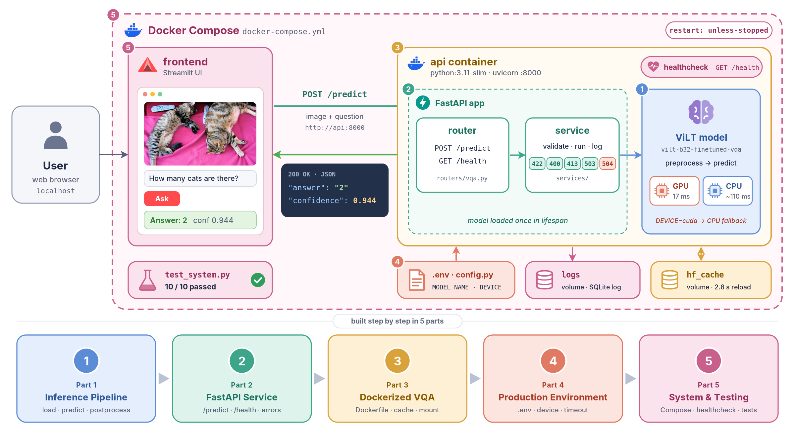
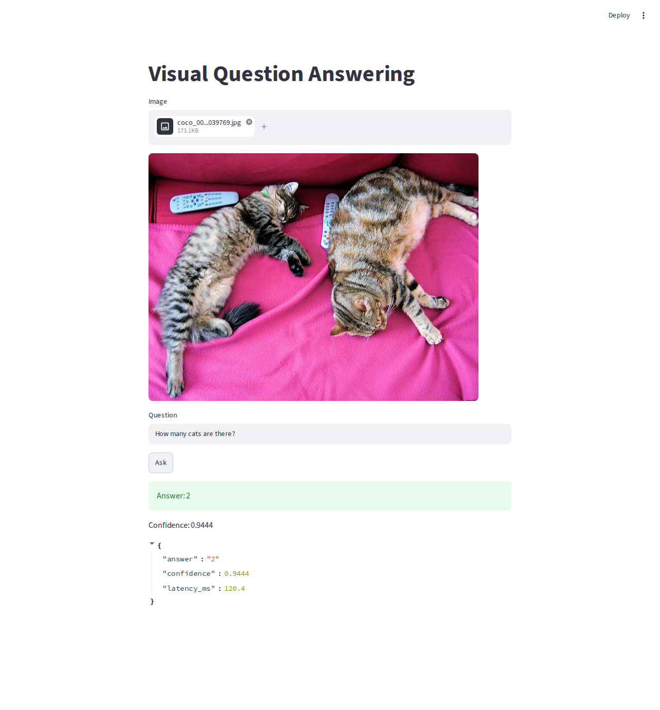

# VQA Deployment in Production

This repo serves [ViLT](https://huggingface.co/dandelin/vilt-b32-finetuned-vqa) (`dandelin/vilt-b32-finetuned-vqa`),
a visual question answering model: you give it an image and a question in English, and it returns a short answer
with a confidence score. Over five parts it takes the model from a single Python script to a Docker Compose
system with a REST API, a web UI and a request log.



## What you will learn

- **01 - Inference pipeline**: load ViLT once and split inference into preprocess, predict and postprocess, then time it on CPU and GPU.
- **02 - FastAPI service**: serve the model behind `/health` and `/predict` (router / service / registry), with input validation and clear HTTP errors.
- **03 - Docker**: build a CPU Docker image that uses layer caching and keeps the model weights in a mounted cache instead of the image.
- **04 - Production environment**: configure with `.env`, add request logging and an inference timeout, and build both CPU and CUDA images.
- **05 - Compose system**: run the API and a Streamlit UI with Docker Compose, using healthchecks, named volumes and a SQLite request log.

## Repository structure

```
.
├── 01-inference-pipeline/   # model.py + run.py: one question from the command line
├── 02-fastapi-service/      # FastAPI app (app/) + client.py
├── 03-docker/               # part 02 in a CPU Docker image (Dockerfile, .dockerignore)
├── 04-production-env/       # env config, logging, timeouts; Dockerfile + Dockerfile.cuda
├── 05-compose-system/       # api/ + frontend/ + docker-compose.yml + test_system.py
└── .gitignore               # venvs, model caches, .env, logs, samples/big_image.jpg
```

Every part also has:

```
<part>/
├── samples/        # three COCO images (+ not_an_image.txt in parts 02-05) and SOURCES.md
└── demo_outputs/   # terminal output recorded from real runs, with a README
```

Each part is self-contained: it has its own requirements, samples and code, so you can run any part on its own
without the others.

## Requirements

- Python 3.11
- Docker with Compose v2 (`docker compose`) for parts 03-05
- Optional: an NVIDIA GPU. GPU containers also need the NVIDIA Container Toolkit (see [GPU support](#gpu-support))
- About 450 MB of disk for the model cache. On the first run the model is downloaded from the Hugging Face Hub,
  so you need internet access.

## Quickstart

```bash
git clone https://github.com/dangnha/vqa-deployment-in-production.git
cd vqa-deployment-in-production
```

Run each part from its own folder. To run Python on the host, create a virtual environment first:

```bash
python3.11 -m venv .venv && source .venv/bin/activate
```

`requests` is only needed on the host, to run `client.py` (parts 02-04) and `test_system.py` (part 05) against the
API. The API containers do not need it; the `pip install requests` lines below install it in your host environment.

### 01 - Inference pipeline

```bash
cd 01-inference-pipeline
pip install -r requirements.txt
python run.py samples/coco_000000039769.jpg "How many cats are there?"
```

It prints the device, the answer (`2`), the confidence, the load time and the inference time.
In `demo_outputs/`, one inference took about 93-121 ms on CPU and about 17 ms on GPU.
More details: [01-inference-pipeline/README.md](01-inference-pipeline/README.md).

### 02 - FastAPI service

```bash
cd 02-fastapi-service
pip install -r requirements.txt
uvicorn app.main:app --port 8701   # terminal 1
python client.py                   # terminal 2
```

Interactive docs: http://localhost:8701/docs

### 03 - Docker

```bash
cd 03-docker
docker build -t vqa-api:03 .
mkdir -p hf_cache
docker run --rm -p 8701:8000 --user "$(id -u):$(id -g)" -v "$(pwd)/hf_cache:/hf_cache" vqa-api:03
pip install requests && python client.py   # from the host, second terminal
```

Docs: http://localhost:8701/docs. In `demo_outputs/` (CPU), the first start took 65.5 s because it downloaded the
model, and the second start took 2.8 s using the cache. The image is 1.7 GB on disk.

### 04 - Production environment

```bash
cd 04-production-env
cp .env.example .env
docker build -t vqa-api:04-cpu .
mkdir -p hf_cache
docker run --rm --env-file .env -p 8701:8000 --user "$(id -u):$(id -g)" -v "$(pwd)/hf_cache:/hf_cache" vqa-api:04-cpu
pip install requests && python client.py   # from the host, second terminal
```

To run without Docker: `set -a; source .env; set +a; HF_HOME=./hf_cache uvicorn app.main:app --port 8701`.
Docs: http://localhost:8701/docs. For the CUDA image, see [GPU support](#gpu-support).

### 05 - Compose system

See [Run the full system](#run-the-full-system-part-05) below. To run it without Docker, use two terminals from `05-compose-system/`:

```bash
cd api && uvicorn app.main:app --port 8701                                               # terminal 1
API_URL=http://localhost:8701/predict streamlit run frontend/app.py --server.port 8702   # terminal 2
```

## Run the full system (part 05)

```bash
cd 05-compose-system
cp .env.example .env               # settings for the api container
docker compose up -d --build       # build both images, start in the background
docker compose ps                  # wait until api is "(healthy)"; the frontend starts after that
```

- Streamlit UI: http://localhost:8702
- API docs: http://localhost:8701/docs

```bash
pip install requests
python test_system.py              # 10 cases + GET /logs; exits with code 1 if any case fails
docker compose down                # stops and removes the containers, KEEPS the volumes
# docker compose down -v           # would ALSO delete the hf_cache and logs volumes
```

The api waits to report healthy until the model has loaded. In `demo_outputs/` (CPU), the first start took 50.2 s
because it downloaded the model into the `hf_cache` volume, and a restart took 2.3 s. Every `/predict` call is
stored in SQLite (`logs` volume), and `GET /logs` returns the last 10 rows.



## Configuration

Parts 04 and 05 read their settings from environment variables. Copy `.env.example` to `.env` and edit it;
`.env` is git-ignored.

| Variable | Default | Meaning |
|---|---|---|
| `MODEL_NAME` | `dandelin/vilt-b32-finetuned-vqa` | Hugging Face model id loaded at startup |
| `DEVICE` | `cuda` | `cuda` or `cpu`; falls back to CPU if no GPU is found |
| `MAX_IMAGE_SIZE` | `5242880` (5 MB) | Max upload size in bytes; larger uploads get 413 |
| `TIMEOUT` | `10` | Max inference time per request in seconds; slower requests get 504 |

HTTP status codes returned by the API:

| Status | When |
|---|---|
| 200 | Answer returned |
| 400 | File is not JPEG/PNG, or its bytes are not a valid image |
| 413 | Image larger than `MAX_IMAGE_SIZE` (5 MB) |
| 422 | Question is empty, or a form field is missing |
| 500 | Inference failed (e.g. the question is longer than ViLT's 40 tokens) |
| 503 | Model is not loaded, or the GPU ran out of memory (parts 04-05) |
| 504 | Inference took longer than `TIMEOUT` (parts 04-05) |

## GPU support

Without any changes, everything runs on CPU. To run the CUDA image (part 04) or to enable the GPU reservation in
`docker-compose.yml` (part 05), install the NVIDIA Container Toolkit and follow the "GPU support" sections in
[04-production-env/README.md](04-production-env/README.md#gpu-support) and
[05-compose-system/README.md](05-compose-system/README.md#gpu-support).

## Troubleshooting

- **Port 8701 or 8702 already in use**: stop the other process or container that uses it, or change the host port
  (`-p 8701:8000`, `--port`, or `ports:` in `docker-compose.yml`). `client.py` and `test_system.py` call
  `http://localhost:8701`, so if you change the API port, update `BASE_URL` in those files too.
- **Slow first start**: the first run downloads the model (about 450 MB), and later starts read it from the cache
  (`hf_cache/` folder or volume). With a slow connection the part 05 api can be marked unhealthy before the
  download finishes. Once `docker compose ps` shows it as healthy, run `docker compose up -d` again.
- **`docker run --gpus all` fails** with `failed to discover GPU vendor from CDI` or `could not select device driver`:
  the NVIDIA Container Toolkit is missing. Run the CPU image, or install the toolkit (see [GPU support](#gpu-support)).
- **Root-owned files in `hf_cache/`**: with a bind mount, a container started without `--user` writes the files as
  root. Start it with `--user "$(id -u):$(id -g)"` so the files belong to you, as in the commands above.
- **413 Request Entity Too Large**: images over 5 MB are rejected. Resize the image, or raise `MAX_IMAGE_SIZE` (parts 04-05).
- **500 Inference failed: The size of tensor a ...**: the question is longer than ViLT's 40 tokens. Ask a shorter question.
- **`samples/big_image.jpg` not found** (the curl 413 demo in parts 02/03): create it first (about 7 MB, git-ignored):
  `python -c "from PIL import Image; Image.open('samples/coco_000000039769.jpg').resize((4800, 3600)).save('samples/big_image.jpg', quality=100)"`

## Sample images

The samples are three images from the COCO 2017 validation set. Attribution and licenses for each image are in each part's `samples/SOURCES.md`.
